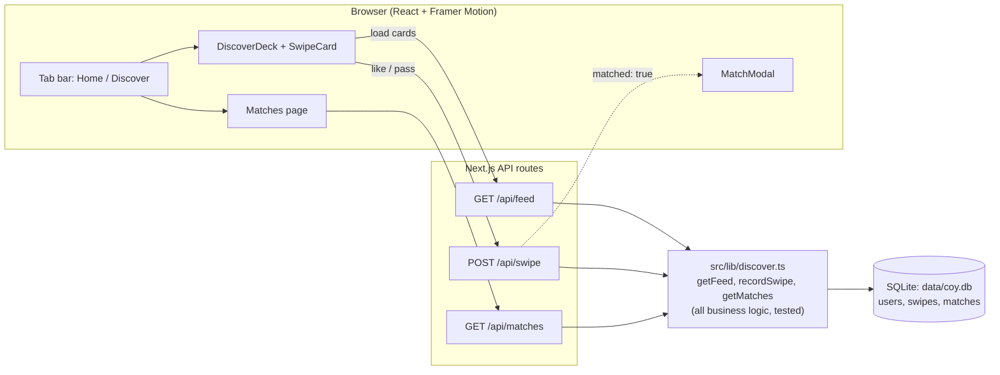
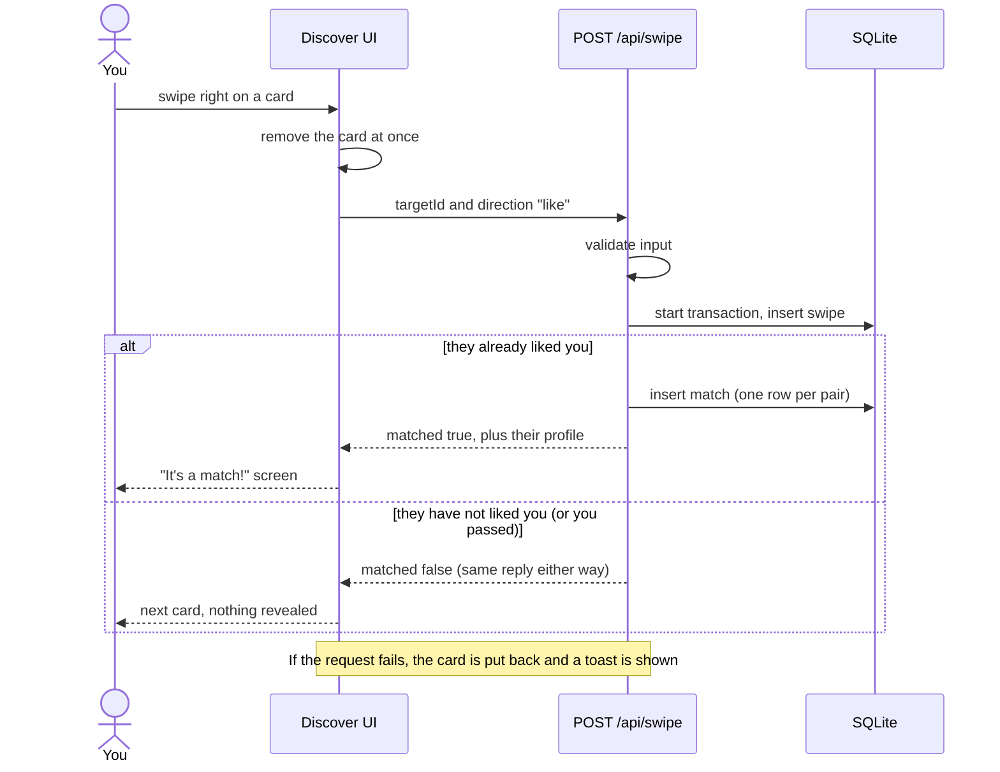

# coy · Discover

A swipe-based **Discover** tab, built for the Coy SDE Intern assignment (Part B). It's a standalone Next.js app with a placeholder **Home** tab (intentionally blank) and the full **Discover** experience: swipe cards, mutual matching, an "It's a match!" screen and a Matches list.

The look follows Coy's own app (colours, Bricolage Grotesque font, thick ink borders, hard drop shadows), taken from app.getcoy.com's public CSS.

> **Core promise: Coy never reveals who liked you unless it's mutual.** Every design choice below protects that. See [Privacy decisions](#privacy-decisions).

## Features

- One profile card at a time. Drag right to like and left to pass (mobile), or use the ✕ / ♥ buttons or the ← / → keys (desktop)
- Tilt, LIKE / NOPE stamps, fly-off and spring-back animations, with optimistic updates and rollback on error
- A swiped profile never appears again, even after a reload
- A match only happens when both people have liked each other, and it triggers the "It's a match!" screen
- A Matches view listing every mutual match (opened from the pill in Discover's header)
- Empty, loading and error states; respects "reduce motion"
- 32 seeded profiles, 10 of whom have already liked you so matches happen in a demo

## Stack

| Layer | Choice |
|---|---|
| Frontend | Next.js 15 (App Router), React, TypeScript, Tailwind CSS v4, Framer Motion |
| Backend | Next.js API routes |
| Data | SQLite via `better-sqlite3` (file at `data/coy.db`) |
| Tests | Vitest, against an in-memory SQLite database |

## Run it

```bash
npm install
npm run seed      # creates data/coy.db with 32 profiles (resets any existing data)
npm run dev       # http://localhost:3000
```

Other scripts: `npm test`, `npm run lint`, `npm run build && npm start`.

Needs internet access for the placeholder photos (`i.pravatar.cc`). Developed on Node 26.

### Try a match

These profiles have already liked you: **Aarav, Vihaan, Kabir, Meera, Advait, Tara, Aditya, Zara, Pari, Ishaan**. Like any of them and the "It's a match!" screen appears. Liking anyone else just moves on. Nothing tells you whether they liked you.

To start over, stop the server and run `npm run seed` again.

## API

The routes live under `/api`. The plain paths named in the brief (`/feed`, `/swipe`, `/matches`) are aliases for the same handlers (see `next.config.ts`).

The single logged-in user is `id = 1` (`src/lib/constants.ts`); there is no auth.

### `GET /api/feed`
Profiles you haven't swiped on, in random order.
```json
{ "profiles": [{ "id": 2, "name": "Aarav", "age": 22, "photoUrl": "…", "bio": "…", "city": "Delhi", "college": "IIT Delhi", "interests": ["Robotics"] }] }
```

### `POST /api/swipe`
Body: `{ "targetId": 2, "direction": "like" | "pass" }`

| Result | Response |
|---|---|
| Created a match | `200 { "matched": true, "match": { …profile, "matchedAt": "…" } }` |
| No match (a pass, or a like that wasn't returned) | `200 { "matched": false }` |
| Already swiped on this profile | `409 ALREADY_SWIPED` |
| Bad `direction` or `targetId` | `400 INVALID_DIRECTION` / `INVALID_TARGET` |
| Swiping on yourself | `400 SELF_SWIPE` |
| Unknown profile | `404 NOT_FOUND` |
| Body isn't a JSON object | `400 INVALID_BODY` |

### `GET /api/matches`
Mutual matches only, newest first: `{ "matches": [{ …profile, "matchedAt": "…" }] }`

Responses are sent with `Cache-Control: no-store`.

## Privacy decisions

1. **No endpoint exposes incoming likes.** There is no "liked you" field, flag or list anywhere. Profiles carry only public fields (`src/lib/discover.ts`, `Profile`).
2. **The feed order doesn't depend on who liked you.** It's shuffled. Putting likers first would leak who they are through the order alone.
3. **A non-mutual like and a pass look identical.** Both return `{ "matched": false }` with the same status.
4. **A pass never becomes a match**, even if the other person already liked you.
5. **Swipes are final.** Changing a pass into a like returns `409`. Otherwise you could pass and re-like someone to probe whether they liked you.
6. **A match is created in one database transaction**, and the primary keys make duplicates impossible, even for duplicate or concurrent requests.

These are covered by tests in `tests/discover.test.ts` (17 tests: feed filtering, matching, duplicates, validation, and five privacy tests).

## How it's built

### Architecture



The route handlers are thin: they validate input and call `discover.ts`. All the matching and privacy rules live in that one tested file.

### What happens on a swipe



Data model: `users`, `swipes` (one row per swiper and target; `like` or `pass`) and `matches` (one row per pair, stored with `user_a < user_b`).

```
src/app/(tabs)/        Home (blank), Discover, Discover/Matches
src/components/        TabBar, SwipeCard, ProfileCard, DiscoverDeck, MatchModal, …
src/lib/               db, discover (logic), http (API helpers), client/api
scripts/seed.ts        seed data
tests/                 Vitest tests
```

## Trade-offs and what I'd do next

- **Single user, no auth**, as the brief allows. `CURRENT_USER_ID` is the one place real auth would plug in.
- **SQLite on local disk.** Simple and persistent, but a serverless host with no writable disk (like Vercel) would need a hosted database such as Turso.
- **The feed returns all unseen profiles at once.** Fine for 32; a real feed would paginate.
- **Next steps:** real authentication, rate limiting on `/swipe`, a real-time match notification, an "undo" that doesn't leak likes, and moderation/reporting.
